<p align="center">
  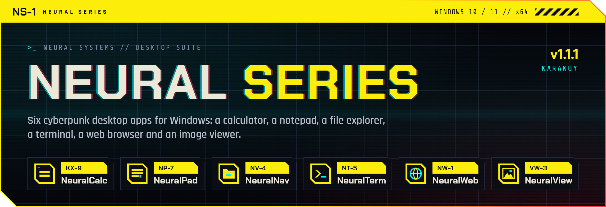
</p>

<p align="center">
  <a href="https://github.com/yigitcakmakci/neural-series/releases/latest"></a>
  
  
  
  <a href="LICENSE"></a>
</p>

<p align="center">
  <b>NeuralCalc KX-9 &nbsp;·&nbsp; NeuralPad NP-7 &nbsp;·&nbsp; NeuralNav NV-4 &nbsp;·&nbsp; NeuralTerm NT-5 &nbsp;·&nbsp; NeuralWeb NW-1 &nbsp;·&nbsp; NeuralView VW-3</b><br>
  <a href="https://github.com/yigitcakmakci/neural-series/releases/latest"><b>Download</b></a> &nbsp;·&nbsp;
  <a href="#install">Install</a> &nbsp;·&nbsp;
  <a href="#user-guide">User guide</a> &nbsp;·&nbsp;
  <a href="#build-from-source">Build from source</a> &nbsp;·&nbsp;
  <a href="CHANGELOG.md">Changelog</a>
</p>

> [!IMPORTANT]
> **Neural Series is a personal fantasy, not a product.** I love the cyberpunk genre: rain-soaked neon streets, chrome,
> humming terminals, interfaces that look like they were bolted onto a machine. One day I wondered what my everyday desktop
> tools would look like if they came from that world, and this project is the answer. There is no company behind it,
> no roadmap and no promises. "Neural Systems" and the city of Neo-Istanbul exist only inside these apps. The code is open
> so that anyone who shares the same fantasy can use it, learn from it or build their own version.

---

<a id="overview"></a>

## `// 01` What is Neural Series?

Neural Series is a family of six desktop apps for Windows that share one design language: chamfered device frames,
a yellow model band with hazard stripes, scanlines, a soft CRT glow and a beam that slowly sweeps the screen. Each app
carries a model code like a piece of hardware from a fictional maker, Neural Systems.

They are not mock-ups. They are the tools I use every day:

- **Real apps, real work.** NeuralWeb is my daily browser, NeuralNav can take over from File Explorer, NeuralTerm runs
  PowerShell, Command Prompt, Git Bash and WSL, NeuralPad opens and saves real text files in several encodings, and
  NeuralView pages through the pictures of a folder.
- **At home in Windows.** Every app has its own executable, icon and taskbar identity, its own Start menu entry, and
  optional hooks into Windows: *Open with*, folder context menus, `nt` in the Run box, a registered web browser.
- **One installer, fully reversible.** A single setup installs any combination of the apps for the current user only,
  with no administrator rights, and its uninstaller puts every Windows setting back the way it was.
- **No telemetry.** Nothing is collected or sent anywhere (see [Privacy and network](#privacy)).

<p align="center">
  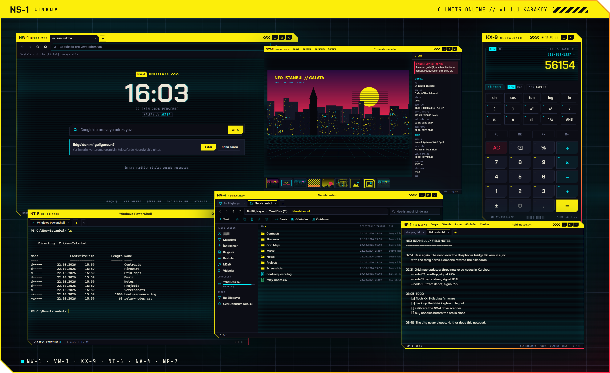
</p>

<a id="lineup"></a>

## `// 02` The lineup

| | Unit | Model | Version | What it is |
|:-:|---|:-:|:-:|---|
| 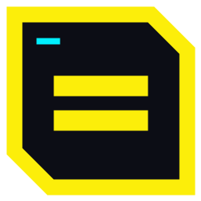 | **NeuralCalc** | `KX-9` | 1.1.1 | Scientific calculator with a readout screen, memory and keyboard input |
| 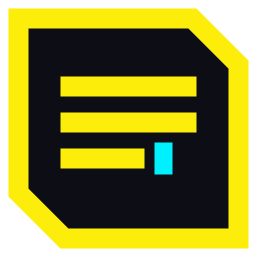 | **NeuralPad** | `NP-7` | 1.1.1 | Tabbed notepad with find and replace, encodings, sessions and themes |
| 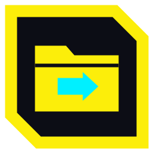 | **NeuralNav** | `NV-4` | 1.1.1 | Tabbed file explorer that can stand in for Windows File Explorer |
| 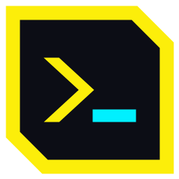 | **NeuralTerm** | `NT-5` | 1.1.1 | Terminal for PowerShell, PowerShell 7, Command Prompt, Git Bash and WSL |
| 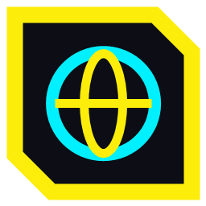 | **NeuralWeb** | `NW-1` | 1.1.1 | Chromium-based web browser with an ad and tracker shield and a password manager |
| 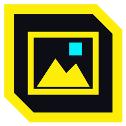 | **NeuralView** | `VW-3` | 1.1.1 | Image viewer with folder browsing, zoom, lossless JPEG rotation and EXIF details |

The series itself is versioned as a whole: **Neural Series 1.1.1, codename "Karakoy"**, built on Electron 44.5.1.
See [Versions](#versions) and the [changelog](CHANGELOG.md).

> [!NOTE]
> The apps speak **Turkish**: menus, dialogs and messages are in Turkish, and so are some code comments. This guide gives
> the English meaning of the labels you will meet.

<a id="install"></a>

## `// 03` Install

**Requirements:** Windows 10 or 11 (64-bit), about 1.5 GB of disk space. The apps carry their own typefaces and work
offline; NeuralWeb needs a connection to browse, of course, and to refresh its blocking lists.

1. Download **`Neural-Setup-1.1.1.exe`** from the [latest release](https://github.com/yigitcakmakci/neural-series/releases/latest).
2. Run it. The setup is not code-signed, so Windows SmartScreen may say *"Windows protected your PC"*. Choose
   **More info → Run anyway**. You can compare the file's SHA-256 with the one in the release notes first:
   ```powershell
   Get-FileHash .\Neural-Setup-1.1.1.exe -Algorithm SHA256
   ```
3. Follow the wizard: pick the apps and the folder (default `%USERPROFILE%\Neural`), then choose how far the apps may
   hook into Windows. Every option can be changed later by running the setup again.

<p align="center">
  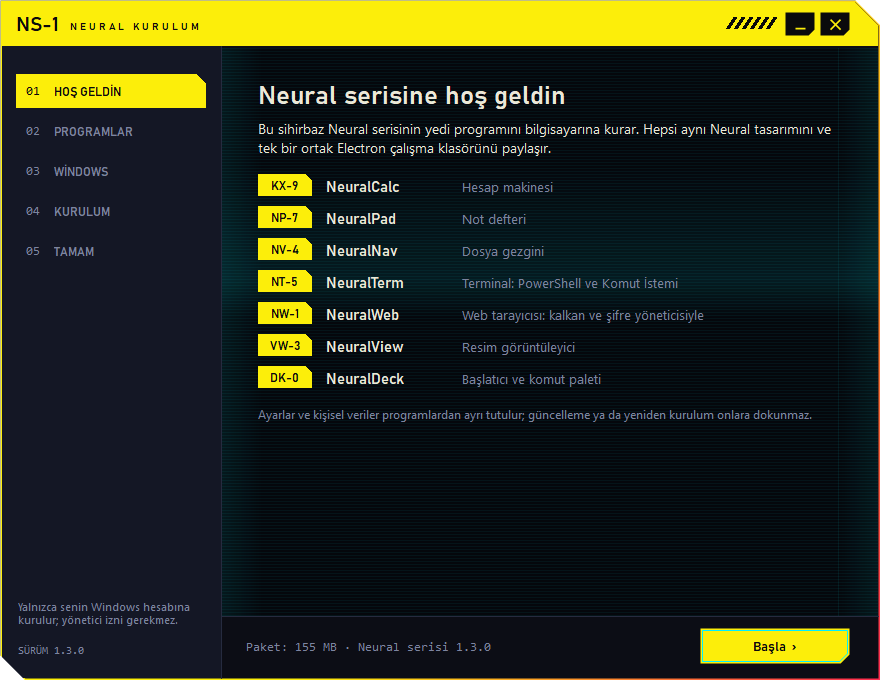
  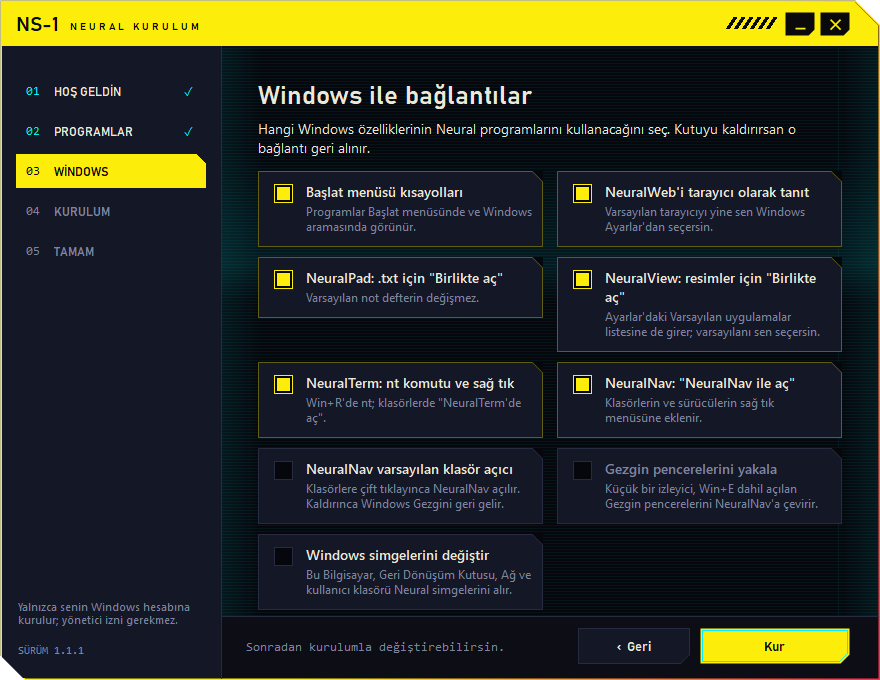
</p>

| Windows option (in the wizard) | Default | What it does |
|---|:-:|---|
| Start menu shortcuts (*Başlat menüsü kısayolları*) | on | The apps appear in Start and in Windows search |
| Register NeuralWeb as a browser (*NeuralWeb'i tarayıcı olarak tanıt*) | on | NeuralWeb is offered in **Settings → Apps → Default apps**; choosing it stays with you |
| NeuralPad in *Open with* for `.txt` | on | Your default text editor does not change |
| NeuralView in *Open with* for images | on | JPEG, PNG, GIF, WebP, BMP, ICO, SVG and AVIF; NeuralView also appears in **Settings → Apps → Default apps**, where you can make it your default picture app |
| NeuralTerm `nt` command and context menu | on | `Win+R` → `nt`; *"Open in NeuralTerm"* on folders and drives |
| *"Open with NeuralNav"* context menu | on | Adds NeuralNav to the right-click menu of folders and drives |
| NeuralNav as the default folder opener | off | Double-clicking a folder opens NeuralNav instead of File Explorer |
| Catch File Explorer windows (*Gezgin pencerelerini yakala*) | off | A small watcher hands Explorer windows (including `Win+E`) to NeuralNav |
| Change Windows icons (*Windows simgelerini değiştir*) | off | This PC, Recycle Bin, Network and the user folder get Neural icons |

**Updating.** Run a newer setup; it finds the existing installation, keeps your options and never touches your
settings or personal data. Apps added to the series since your last install (like NeuralView in 1.1.0) are offered
as checked; an app you leave out stays out at later updates.

**Uninstalling.** Use **Settings → Apps → Installed apps → Neural serisi**. The uninstaller removes the apps,
shortcuts and every Windows registration it made, so folders open in File Explorer again. Your settings, bookmarks,
passwords and notes are kept unless you tick *"Ayarlarımı ve kişisel verilerimi de sil"* (also delete my settings
and personal data).

<details>
<summary><b>Where things live</b></summary>

| What | Where |
|---|---|
| Programs | `%USERPROFILE%\Neural\<App>\Program` (shared runtime in `Neural\Ortak\Electron`) |
| Settings and personal data | `%APPDATA%\NeuralCalc KX-9`, `%APPDATA%\NeuralPad`, `%APPDATA%\NeuralNav`, `%APPDATA%\NeuralTerm`, `%APPDATA%\NeuralWeb`, `%APPDATA%\NeuralView` |
| Shortcuts to those data folders | `%USERPROFILE%\Neural\Veriler` |
| Uninstaller | `%USERPROFILE%\Neural\Ortak\NeuralKaldir.exe` |
| Setup log | `%TEMP%\neural-kurulum.log` |

</details>

<details>
<summary><b>Unattended install (switches)</b></summary>

The switches are Turkish, like the rest of the interface.

```powershell
# install everything silently with the default options
.\Neural-Setup-1.1.1.exe /sessiz

# pick apps, options and folder; write a log
.\Neural-Setup-1.1.1.exe /sessiz /uygulamalar:NeuralWeb,NeuralTerm /secenekler:baslat,web,nt /hedef:D:\Apps\Neural /gunluk:C:\Temp\neural.log

# uninstall silently (add /veriler to delete settings and personal data too)
& "$env:USERPROFILE\Neural\Ortak\NeuralKaldir.exe" /kaldir /sessiz
```

Options for `/secenekler`: `baslat` (Start menu), `web` (register NeuralWeb), `pad` (NeuralPad in *Open with*),
`view` (NeuralView in *Open with*), `nt` (NeuralTerm command and menu), `navmenu` (NeuralNav menu), `navvarsayilan` (NeuralNav as default folder opener),
`izleyici` (Explorer watcher), `simge` (Windows icons). Exit code `0` means success.

</details>

<a id="user-guide"></a>

## `// 04` User guide

Every app is a frameless window: drag it by the yellow band, resize it from any edge, and use the small black-and-yellow
buttons on the right of the band to minimize, maximize or close. Each app remembers its window position. NeuralPad,
NeuralNav, NeuralTerm, NeuralWeb and NeuralView come with four color themes: **Neon**, **Buz** (Ice), **Alarm** and **Gündüz** (Daylight).

###  NeuralCalc `KX-9`

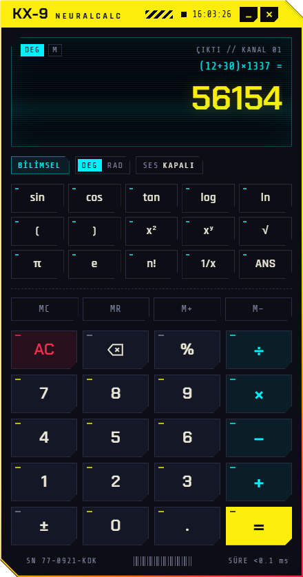

A calculator built like a handheld device. The readout shows the whole expression above the result.

- **BİLİMSEL** (scientific) shows the function keys: `sin`, `cos`, `tan`, `log`, `ln`, powers, roots, `π`, `e`, factorial, `1/x`.
- **DEG / RAD** switches the angle unit; **SES** turns the key clicks on or off (*KAPALI* = off).
- **MC / MR / M+ / M−** work with one memory slot, and **ANS** brings back the last result.
- Percent works the natural way: `200 + 15%` means *200 plus 15 percent of 200*.

**Keyboard:** digits and `.` or `,` · `+ - * / ^` · `( )` · `%` · `!` · `Enter` or `=` to evaluate ·
`Backspace` to delete · `Esc` to clear · `s` sin · `c` cos · `t` tan · `g` log · `l` ln · `r` √ · `p` π · `e` e · `a` ANS

<br clear="right">

###  NeuralPad `NP-7`

<p align="center">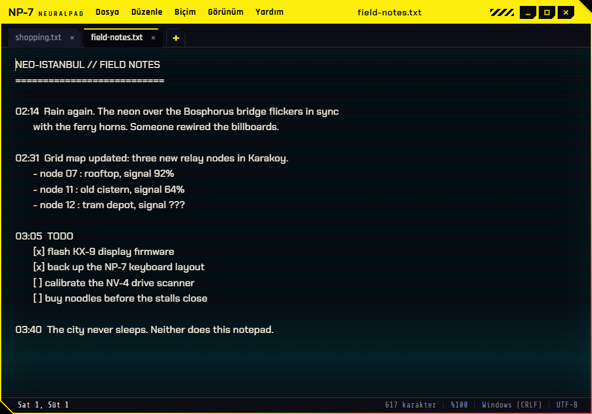</p>

A notepad with tabs. The menus are *Dosya* (File), *Düzenle* (Edit), *Biçim* (Format), *Görünüm* (View) and *Yardım* (Help).

- Several files in tabs and several windows; the main window restores its tabs, including unsaved ones, next time.
- Find, replace and *go to line*; word wrap, zoom, print, font choice and the four themes.
- Reads and writes UTF-8, UTF-16 and Turkish ANSI (Windows-1254), keeps Windows (CRLF), Unix (LF) or classic Mac (CR)
  line endings, and shows both in the status bar.

<details>
<summary><b>NeuralPad shortcuts</b></summary>

| Action | Keys |
|---|---|
| New tab / new window | `Ctrl+N` / `Ctrl+Shift+N` |
| Open / save / save as / save all | `Ctrl+O` / `Ctrl+S` / `Ctrl+Shift+S` / `Ctrl+Alt+S` |
| Print | `Ctrl+P` |
| Close tab / close window | `Ctrl+W` / `Ctrl+Shift+W` or `Alt+F4` |
| Next / previous tab | `Ctrl+Tab` / `Ctrl+Shift+Tab` |
| Undo / redo | `Ctrl+Z` / `Ctrl+Y` |
| Find / find next / find previous | `Ctrl+F` / `F3` / `Shift+F3` |
| Replace / replace all (in the replace box) | `Ctrl+H` / `Ctrl+Alt+Enter` |
| Go to line | `Ctrl+G` |
| Zoom in / out / reset | `Ctrl++` / `Ctrl+-` / `Ctrl+0`, or `Ctrl` + mouse wheel |

</details>

###  NeuralNav `NV-4`

<p align="center">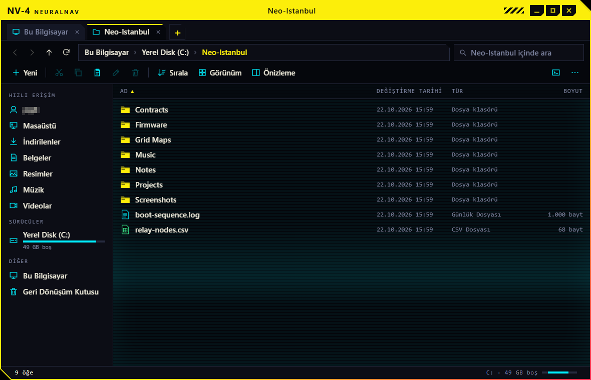</p>

A file explorer with tabs. The sidebar holds quick access (*Hızlı erişim*), drives (*Sürücüler*), This PC
(*Bu Bilgisayar*) and the Recycle Bin (*Geri Dönüşüm Kutusu*).

- Breadcrumb address bar that turns into a text box, search inside the current folder, sorting (*Sırala*), details or
  tiles view (*Görünüm*) and a preview pane (*Önizleme*) for images and text.
- Copy and move run as background jobs and ask what to do when names clash; deleting goes to the Recycle Bin, and the
  last operation can be undone.
- Right-click offers *Open with*, *Open in NeuralPad* for text files, *Open in NeuralView* (*NeuralView ile aç*) for
  images, *copy path* and properties. The terminal button opens
  NeuralTerm in the current folder.
- Optionally the default folder opener of Windows (see [Install](#install)).

<details>
<summary><b>NeuralNav shortcuts</b></summary>

| Action | Keys |
|---|---|
| Open | `Enter` or double-click |
| Back / forward / up | `Alt+←` / `Alt+→` / `Alt+↑` |
| Address bar / search | `Ctrl+L`, `Alt+D` or `F4` / `Ctrl+F` or `Ctrl+E` |
| Refresh | `F5` |
| New tab / close tab / next tab | `Ctrl+T` / `Ctrl+W` / `Ctrl+Tab` |
| New window / new folder | `Ctrl+N` / `Ctrl+Shift+N` |
| Rename | `F2` |
| Cut / copy / paste | `Ctrl+X` / `Ctrl+C` / `Ctrl+V` |
| Move to Recycle Bin / delete permanently (asks first) | `Del` or `Ctrl+D` / `Shift+Del` |
| Undo | `Ctrl+Z` |
| Copy path / properties / preview pane | `Ctrl+Shift+C` / `Alt+Enter` / `Alt+P` |

</details>

###  NeuralTerm `NT-5`

<p align="center">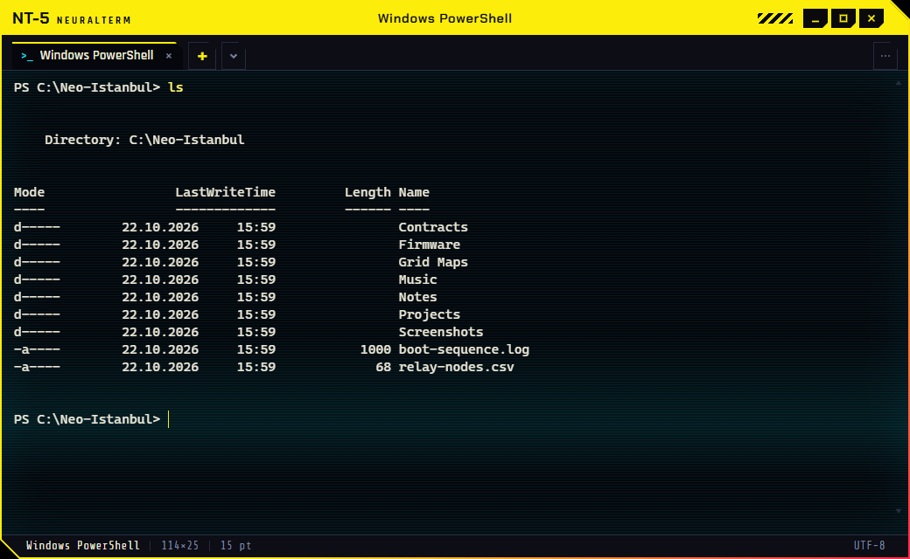</p>

A terminal with tabs, built on xterm.js and a small bridge to the Windows pseudo console (ConPTY), the same console
interface Windows Terminal uses.

- Shells it finds on your PC: Windows PowerShell, PowerShell 7, Command Prompt (*Komut İstemi*), Git Bash and WSL.
  The `⌄` button next to `+` opens a tab with any of them; the default is set under *Varsayılan kabuk* in the `⋯` menu.
- Start it from anywhere: `Win+R` → `nt`, or right-click a folder → *"NeuralTerm'de aç"* (open in NeuralTerm).
- Right-click copies when text is selected and pastes otherwise. When a shell exits, `Enter` restarts it.

<details>
<summary><b>NeuralTerm shortcuts</b></summary>

| Action | Keys |
|---|---|
| New tab (default shell) / with a given shell | `Ctrl+Shift+T` / `Ctrl+Shift+1` … `5` |
| Close tab / next / previous tab | `Ctrl+Shift+W` / `Ctrl+Tab` / `Ctrl+Shift+Tab` |
| New window | `Ctrl+Shift+N` |
| Copy | `Ctrl+C` with a selection, or `Ctrl+Shift+C` |
| Paste | `Ctrl+V` or `Ctrl+Shift+V` |
| Stop the running command | `Ctrl+C` without a selection |
| Font size | `Ctrl+=` / `Ctrl+-` / `Ctrl+0`, or `Ctrl` + mouse wheel |

</details>

###  NeuralWeb `NW-1`

<p align="center">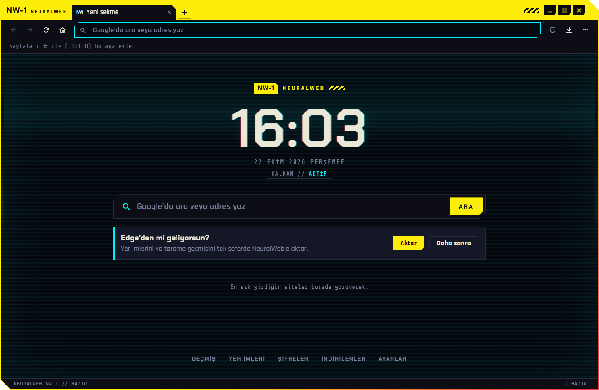</p>

A Chromium-based browser (through Electron) dressed as a field terminal. The new tab page shows a clock, the search box
and your most visited sites. Searches and suggestions come from Google.

- **Shield (*Kalkan*):** blocks ads, trackers and known malicious addresses before the page loads, using the Ghostery
  ad-blocker engine with the EasyList, EasyPrivacy, uBlock Origin and Peter Lowe lists. The shield icon in the address bar
  turns it off for a single site.
- **Passwords (*Şifreler*):** offers to save sign-ins, fills them in, and keeps them encrypted with your Windows account.
  Showing a saved password asks for **Windows Hello** first.
- **Import from Edge (*Edge'den aktar*):** copies bookmarks, history and saved passwords from Microsoft Edge in one go;
  Edge keeps its own data.
- Tabs and private windows (*gizli pencere*), bookmarks bar and manager, history, downloads, find in page, zoom, print,
  developer tools, site permissions, and the four themes.

<p align="center">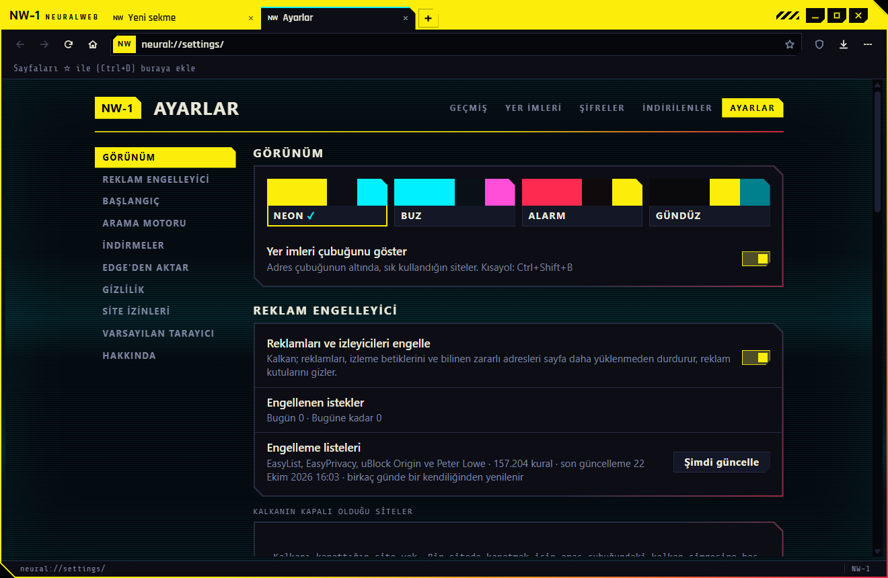</p>

<details>
<summary><b>NeuralWeb shortcuts</b></summary>

| Action | Keys |
|---|---|
| New tab / new window / new private window | `Ctrl+T` / `Ctrl+N` / `Ctrl+Shift+N` |
| Close tab / reopen closed tab | `Ctrl+W` or `Ctrl+F4` / `Ctrl+Shift+T` |
| Next / previous tab / go to the last tab | `Ctrl+Tab` or `Ctrl+PgDn` / `Ctrl+Shift+Tab` or `Ctrl+PgUp` / `Ctrl+9` |
| Address bar | `Ctrl+L`, `Alt+D`, `F6`, `Ctrl+K` or `Ctrl+E` |
| Back / forward / home | `Alt+←` / `Alt+→` / `Alt+Home` |
| Reload / reload without cache | `F5` or `Ctrl+R` / `Ctrl+F5`, `Shift+F5` or `Ctrl+Shift+R` |
| Bookmark this page / bookmarks bar / bookmark manager | `Ctrl+D` / `Ctrl+Shift+B` / `Ctrl+Shift+O` |
| History / downloads | `Ctrl+H` / `Ctrl+J` |
| Find in page | `Ctrl+F`, `F3` or `Ctrl+G` |
| Zoom in / out / reset | `Ctrl++` / `Ctrl+-` / `Ctrl+0` |
| Print / page source / developer tools | `Ctrl+P` / `Ctrl+U` / `F12` or `Ctrl+Shift+I` |
| Full screen | `F11` |
| Clear browsing data | `Ctrl+Shift+Del` |

</details>

###  NeuralView `VW-3`

<p align="center">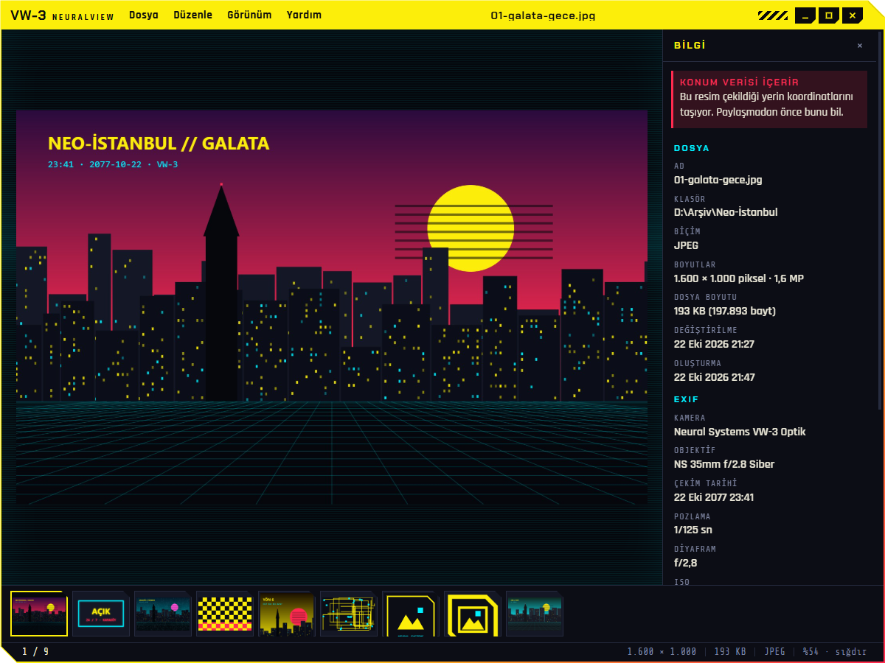</p>

An image viewer. Open a picture (through *Open with*, by dragging it onto the window, or with *Dosya → Aç*) and the
whole folder comes with it: step through it with the arrow keys, the mouse wheel or the
thumbnail strip at the bottom, sorted by name, date or size (*Görünüm → Sırala*).

- **Formats:** JPEG, PNG, GIF (animated), WebP, BMP, ICO, SVG and AVIF. HEIC/HEIF photos are listed, but NeuralView
  says plainly that it cannot open them; export them as JPEG or PNG first.
- **Zoom:** the picture fits the window; `1` shows it at actual size, `Ctrl` + wheel zooms around the pointer, dragging
  pans, and a double-click switches between fit and 100 %. `F11` is full screen, `Space` starts a slideshow.
- **Rotate:** `R` / `Shift+R` turn the picture on screen; NeuralView asks before it saves. JPEG rotation is lossless
  (only the EXIF orientation changes), PNG and BMP are written again without loss, WebP at the highest quality.
- **Information panel** (`I`, *Bilgi*): dimensions, file size, dates and EXIF data: camera, lens, exposure, aperture,
  ISO and focal length. A picture that carries GPS coordinates is flagged with *"KONUM VERİSİ İÇERİR"* (contains
  location data), worth knowing before you share it.
- Copy the picture or its path, show the file in NeuralNav, rename it, or move it to the Recycle Bin (asks first).
- **Open pictures with a double-click:** make NeuralView your default picture app. Windows lets only you change a
  default, so the setup never does it on its own: use **"Varsayılan resim uygulaması yap…"** (make it the default
  picture app) on the setup's last page, or **Settings → Apps → Default apps → NeuralView**, and pick it for the
  picture types you want.

<details>
<summary><b>NeuralView shortcuts</b></summary>

| Action | Keys |
|---|---|
| Next / previous image | `→` / `←`, mouse wheel, or the mouse's back and forward buttons |
| First / last image | `Home` / `End` |
| Fit to window / actual size | `0` / `1` (also with `Ctrl`), or double-click |
| Zoom in / out | `+` / `-`, or `Ctrl` + mouse wheel |
| Rotate right / left / save the rotation | `R` / `Shift+R` / `Ctrl+S` |
| Information panel / thumbnail strip | `I` / `T` |
| Full screen / slideshow / leave either | `F11` / `Space` / `Esc` |
| Copy picture / copy path | `Ctrl+C` / `Ctrl+Shift+C` |
| Show in NeuralNav | `Ctrl+E` |
| Rename / move to Recycle Bin | `F2` / `Del` |
| Open / shortcut list | `Ctrl+O` / `?` or `F1` |

</details>

<a id="under-the-hood"></a>

## `// 05` Under the hood

- **One runtime, six identities.** All apps run on one copy of Electron 44.5.1 in `Neural\Ortak\Electron`; each app
  folder holds NTFS hard links to it, so the runtime takes disk space once. Every app gets its own copy of
  `electron.exe` with its own icon, name and version written in through the Windows resource API, and its own
  AppUserModelID, so the taskbar groups and pins it as a separate program.
- **Windows helpers in C#.** Small helpers are compiled with the C# compiler that ships with Windows:
  `nvhelper` (shell operations) and `nvwatch` (Explorer watcher) for NeuralNav, `ntpty` (ConPTY bridge) for NeuralTerm,
  `nwdpapi` (Edge import) and `nwhello` (Windows Hello) for NeuralWeb.
- **The setup** is a C# 5 WinForms program drawn in the same style. The payload is a zip appended to the executable;
  every file is checked against its CRC while it is written, so a damaged download stops the setup instead of
  installing broken files. A `/test` mode keeps every Windows change inside a separate registry key and folder.

```text
neural-series/
├─ apps/                 the six apps (Electron main and renderer code, C# helpers, icons)
│  ├─ neuralcalc/        KX-9
│  ├─ neuralpad/         NP-7
│  ├─ neuralnav/         NV-4
│  ├─ neuralterm/        NT-5
│  ├─ neuralweb/         NW-1
│  └─ neuralview/        VW-3
├─ installer/src/        setup and uninstaller (C#)
├─ assets/windows-icons/ optional icon set for This PC, Recycle Bin, Network, user folder
├─ tools/                icon generator and test helpers (DevTools client, screenshots, keystrokes)
├─ tests/                end-to-end and unit tests per app
├─ docs/                 README images and the pages they are rendered from
└─ build.ps1             clean clone → out\Neural-Setup-<version>.exe
```

<a id="build-from-source"></a>

## `// 06` Build from source

You need Windows 10 or 11 (64-bit) and [Node.js](https://nodejs.org/) 20 or newer with npm. PowerShell 5.1 and the
.NET Framework C# compiler are already part of Windows.

```powershell
git clone https://github.com/yigitcakmakci/neural-series.git
cd neural-series
powershell -ExecutionPolicy Bypass -File build.ps1
```

`build.ps1` restores the exact dependency versions from the lock files (Electron, xterm.js, the typefaces from
[Fontsource](https://fontsource.org/), the Ghostery ad blocker), stages every app as the setup installs it in
`out\stage` (with its `fonts\` folder), compiles the helpers and the setup, and writes
`out\Neural-Setup-1.1.1.exe` together with its SHA-256. Run it with `-SkipNpm` to reuse the existing `node_modules`.

To try a build without touching your Windows settings, install it in test mode:

```powershell
.\out\Neural-Setup-1.1.1.exe /test /hedef:$env:TEMP\neural-test\Neural
```

Other tools: `tools\make-icons.ps1` redraws every icon, `node tools\make-fonts-css.js` rewrites the font style sheets
in `assets\fonts` (which weights and subsets are bundled), and `node_modules\electron\dist\electron.exe docs\src\render.js`
renders the README images. The tests in `tests\` drive the apps over the DevTools protocol with throwaway profiles.
Build first: the README images and some tests use `out\`.

<a id="versions"></a>

## `// 07` Versions

| Release | Codename | Date | Notes |
|---|---|---|---|
| **1.1.1** | **Karakoy** | 2026-10-22 | NeuralView in Windows' Default apps list, and a button in the setup to make it the default |
| 1.1.0 | Karakoy | 2026-10-22 | New unit: the NeuralView VW-3 image viewer, with *Open with NeuralView* in NeuralNav and the setup |
| 1.0.1 | Neo-Istanbul | 2026-10-22 | Bundled typefaces: the apps no longer load fonts from Google Fonts |
| 1.0.0 | Neo-Istanbul | 2026-10-22 | First public release: five apps, the setup and uninstaller |

| Unit | Model | 1.0.0 | 1.0.1 | 1.1.0 | 1.1.1 |
|---|:-:|:-:|:-:|:-:|:-:|
| NeuralCalc | `KX-9` | ✔ | ✔ | ✔ | ✔ |
| NeuralPad | `NP-7` | ✔ | ✔ | ✔ | ✔ |
| NeuralNav | `NV-4` | ✔ | ✔ | ✔ | ✔ |
| NeuralTerm | `NT-5` | ✔ | ✔ | ✔ | ✔ |
| NeuralWeb | `NW-1` | ✔ | ✔ | ✔ | ✔ |
| NeuralView | `VW-3` | | | ✔ | ✔ |

Version numbers follow [Semantic Versioning](https://semver.org/). Every major and minor release gets a codename from
the map of Neo-Istanbul; patch releases (1.0.x, 1.1.x) keep the codename of their line. Details are in the
[changelog](CHANGELOG.md).

<a id="privacy"></a>

## `// 08` Privacy and network

- The apps collect nothing and have no analytics or crash reporting.
- The typefaces are bundled with the apps, so no font is ever fetched from the internet. NeuralCalc, NeuralPad,
  NeuralNav, NeuralTerm and NeuralView do not connect to anything by themselves; NeuralView reads your pictures and
  their EXIF data on your PC only.
- NeuralWeb sends what you type in the address bar to Google for suggestions and search, like most browsers. It
  refreshes its blocking lists from GitHub every few days and, like Chromium, downloads its Turkish and English
  spell-check dictionaries from Google's servers once. Everything else is traffic to the sites you visit.
- Saved passwords are encrypted with your Windows account (Electron `safeStorage`), so other users of the PC cannot read them.

<a id="license"></a>

## `// 09` License and credits

Neural Series is free software under the [GNU General Public License v3.0](LICENSE) or later: you may use, study,
share and change it, and versions you distribute must stay open under the same license.

It stands on the work of others; see [THIRD-PARTY-NOTICES.md](THIRD-PARTY-NOTICES.md): Electron (Chromium and Node.js),
xterm.js, the Ghostery ad-blocker engine and the community filter lists, and the Chakra Petch, Rajdhani, Share Tech Mono,
IBM Plex Mono, JetBrains Mono, Space Mono and Oxanium typefaces.

*Neural Systems, its products and the city of Neo-Istanbul are fictional. This is a fan project inspired by the
cyberpunk genre and is not affiliated with, endorsed by or connected to any company, game or franchise. Windows,
Microsoft Edge and Google are trademarks of their respective owners.*

<p align="center"><sub><code>NS-1 // NEURAL SERIES // BUILT IN NEO-ISTANBUL, ONE NEON SIGN AT A TIME</code></sub></p>
